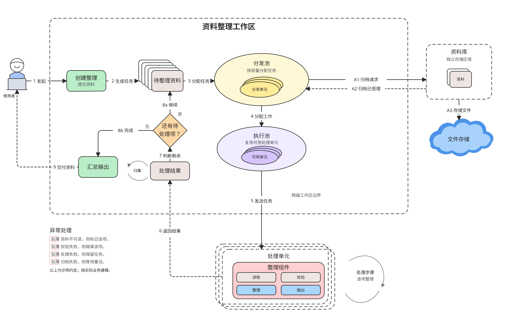
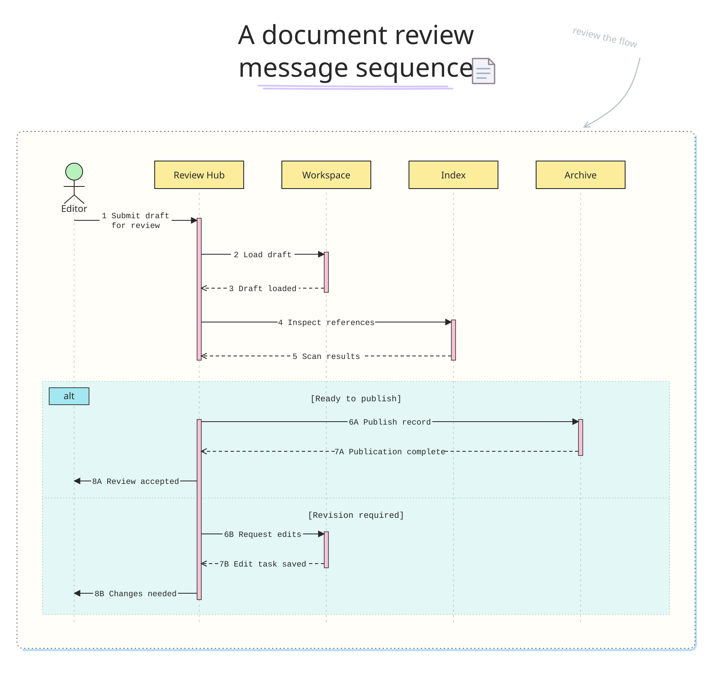
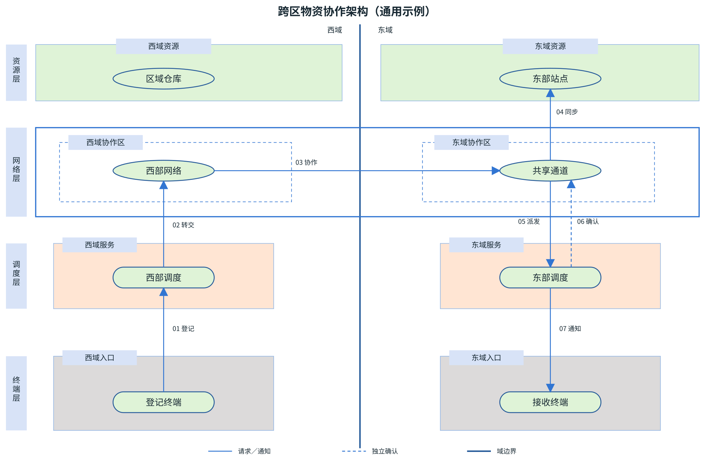
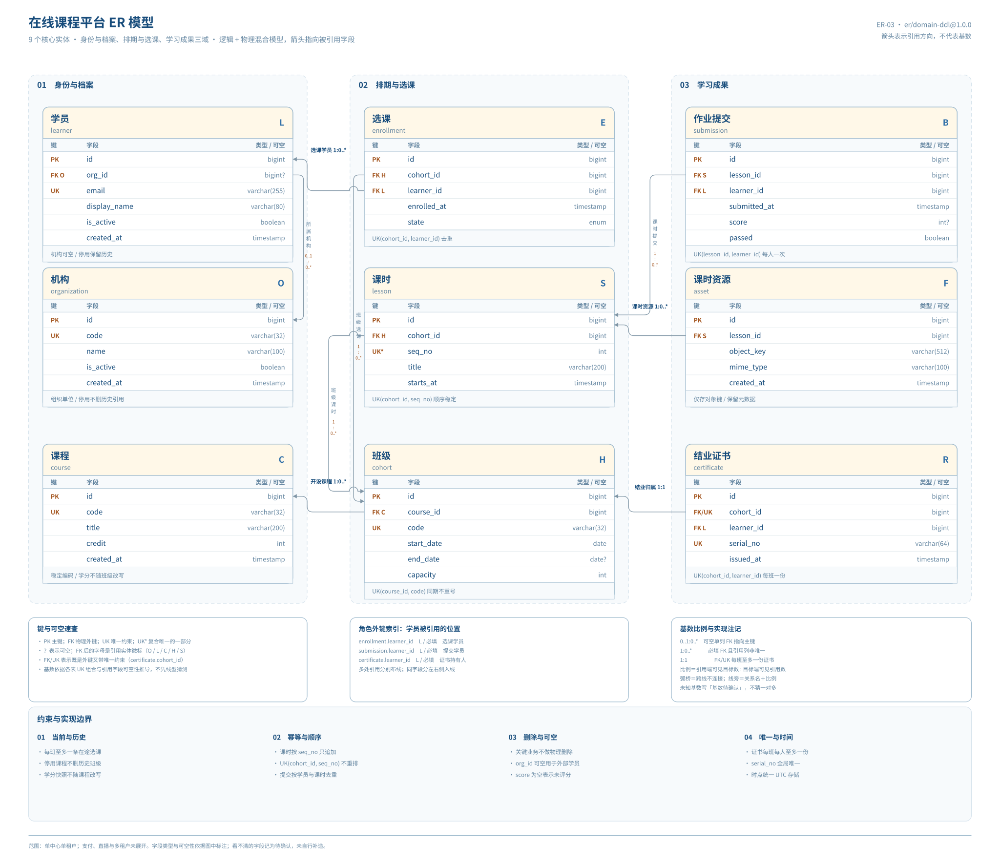

# technical-diagrams：让 AI 帮你绘制技术图

把业务流程、系统调用、状态流转、系统架构、拓扑关系、数据流、时间线和表关系画成**可编辑的 SVG**，并按需导出高清 PNG 或内嵌进 HTML 文档。向支持读取技能文件的 AI 助手描述需求，即可使用本技能提供的图种规范、视觉样式和绘图流程。

**8 类技术图 · 40 个固定风格编号 · 可编辑 SVG · PNG 导出 · 离线 HTML**

## 效果展示

### 流程图 · FC-08



### 时序图 · SQ-05



### 架构图 · AR-08



### ER 图 · ER-03



以上示例展示视觉风格，图中的业务内容不作为新图的默认内容。完整风格可在下载仓库后打开 [风格目录](assets/style-gallery.html) 查看。

## 为什么使用 technical-diagrams

- **覆盖常见技术图**：从业务流程、系统交互到数据库关系，按图种遵循相应语义规范。
- **风格与线条独立选择**：同一图种可选择不同视觉风格和线条形状，不必为了换外观更改业务模型。
- **支持后续修改**：以 SVG 为主要绘制格式，按需导出 PNG 或生成可离线打开的 HTML；记录风格与线条信息供后续复绘。
- **兼顾表达与布局**：关注系统边界、箭头方向、文字、连线及图种特有的语义，绘制后结合渲染结果检查。
- **参考图细节有据可查**：复刻时逐项核对视觉特征；扩展技能时，按授权范围处理参考原图。

## 快速开始

### 1. 让 AI 读取技能

获取本仓库后，在支持读取本地文件的 AI 助手中打开工作区，并发送：

```text
请读取 skills/technical-diagrams/SKILL.md，
使用 FC-08 风格绘制订单处理流程：
用户提交订单后校验库存，库存不足时通知用户，
库存充足时创建订单并发起支付。
输出可编辑 SVG。
```

你可以替换图种、业务内容、风格编号和输出格式。技能按需读取相关规范；具体业务内容由你提供或从你指定的资料中提取，生成结果仍需结合业务核对。

也可以将完整的 `technical-diagrams` 目录安装到所用 AI 助手支持的技能目录，再按该助手的方式调用。不同助手的安装位置和发现方式可能不同；直接让助手读取 `SKILL.md` 本身并不代表已经安装到技能选择器。

### 2. 环境与路径

- 列出和校验风格注册表需要 Python 3.9+；`catalog.py` 只使用标准库。用浏览器查看已生成的画廊不需要 Python。
- 导出 PNG 需要 Node.js 20+、Playwright 和 Chromium；脚本不会自动安装依赖。缺少渲染环境时仍可保留 SVG，并说明未完成的视觉验证。
- `<技能目录>` 是本目录（在本仓库中为 `skills/technical-diagrams/`，安装后为技能目录本身）；`<工作目录>` 必须在技能目录之外，通常使用仓库根目录，临时文件与产物统一放在其 `.data-cache/`。

在仓库根目录可先检查：

```powershell
python -B skills/technical-diagrams/scripts/catalog.py validate
python -B skills/technical-diagrams/scripts/catalog.py list --type flowchart
```

`validate` 返回 `"valid": true` 表示注册表、依赖与冻结基线一致。更多命令见[命令速查](#命令速查进阶)。

## 支持的图种

| 图种 | 适合画 | 风格数 |
|------|--------|--------|
| 流程图 `flowchart` | 业务流程、条件分支、职责泳道 | 10 |
| 时序图 `sequence` | 多方交互、请求/响应、异步回调 | 5 |
| 状态图 `state` | 状态机、迁移事件与条件 | 2 |
| 架构图 `architecture` | 系统分层、模块依赖、外部系统对接 | 15（含历史兼容 AR-14） |
| 拓扑图 `topology` | 节点和连接、网络及设施关系 | 2 |
| 时间线图 `timeline` | 事件顺序、里程碑和时间区间 | 2 |
| 数据流图 `data-flow` | 数据来源、处理、存储和去向 | 1 |
| ER 图 `er` | 逻辑模型、物理表结构、字段级关系 | 3 |

**不做**：自动生成业务内容（模型要你提供或由资料提取）、图片转矢量、动效、在线托管。Mermaid 只能当草稿，正式交付用显式 SVG 几何。

## 查看完整风格目录

下载仓库后，用浏览器打开 [风格目录](assets/style-gallery.html)，可按图种浏览全部 40 个风格编号、示例和调用方式；页面内嵌所需资源，可离线打开。GitHub 的文件页面用于浏览文件内容，不能直接运行这份交互式 HTML；请下载后在本地打开。

<details>
<summary>展开：画廊预览操作</summary>

鼠标悬停卡片可突出显示；点击示例图时，图片从卡片位置展开为深色遮罩的全屏预览，标题与控件全部悬浮。打开示例图或已授权原图后，可拖拽画面平移，**直接滚动鼠标滚轮**即以指针为中心平滑缩放（不需要按 Ctrl；触控板捏合同样生效），`Shift` + 滚轮水平平移，双击在「适应窗口」与 100% 之间切换。底部悬浮工具栏提供缩小、缩放百分比、放大、适应窗口、1:1、旋转 90° 与下载；键盘 `+` / `-` / `0` 也可缩放或回到原尺寸。系统开启减少动态效果时，展开与缩放直接完成。

按 Esc、点击右上角关闭按钮或图片外空白处退出预览。卡片标有「查看原始样例图」时，可用同样方式查看用户授权的原图。页面内嵌所需资源，可离线打开；授权原图索引位于 `assets/reference-examples/index.json`。

</details>

各图种的原图样例、视觉分析、特征展示图和风格选型说明，已按图种拆分到独立指南。需要了解某个风格的细节时只读对应指南，不加载其他图种：

| 图种 | 指南 | 重点内容 |
| --- | --- | --- |
| 流程图 | [flowchart.md](references/type-guides/flowchart.md) | 泳道与节点写法、手绘流程、组件交互与文档处理 |
| 时序图 | [sequence.md](references/type-guides/sequence.md) | SQ-03 分阶段、SQ-04 折角注释 |
| 状态图 | [state.md](references/type-guides/state.md) | 迁移方向与条件 |
| 架构图 | [architecture.md](references/type-guides/architecture.md) | AR-04～AR-15 的原图、分析与特征图 |
| 拓扑图 | [topology.md](references/type-guides/topology.md) | TP-01/TP-02 图标链路与集群 |
| 时间线图 | [timeline.md](references/type-guides/timeline.md) | TL-01/02 的轴与区间精度 |
| 数据流图 | [data-flow.md](references/type-guides/data-flow.md) | DF-01 粉彩手绘与数据标签 |
| ER 图 | [er.md](references/type-guides/er.md) | 字段端口、引用方向与基数 |

风格目录中的通用示例用于演示视觉风格如何应用到其他业务；授权原图的业务和拓扑不作为新图默认内容。AR-08 的[五层特征图](styles/architecture/cross-boundary-layers/1.0.0/feature-atlas.svg)只用于展示视觉特征，固定 profile 仍保留原来的[四层通用示例](styles/architecture/cross-boundary-layers/1.0.0/example.svg)，旧图依赖不变。

参考图分析、复刻和扩展均按[参考图完整性验收](references/reference-image-completeness.md)逐项记录特征、输出位置、覆盖状态和核查依据。新增或完善参考风格时，展示样例应体现适用特征；发现缺漏须补齐，不能同图表达的内容使用标明用途的补充示例。图中业务语义、数据和原图素材仍以来源及授权为准。

如果明确要求把参考图的新风格或图种加入本技能，按需读取[参考图扩展工作流](references/reference-image-extension-workflow.md)完成分析、示例、注册和验收；普通画图或一次性复刻不加载这套扩展流程。

## 更多使用示例

技能已安装并可被助手发现时，可以使用这些词描述需求：**画流程图 / 时序图 / 状态图 / 架构图 / 拓扑图 / 数据流图 / 时间线图 / ER 图 / 技术图 / 风格复刻**。也可明确要求助手读取 `SKILL.md`。

典型说法：

```text
使用 technical-diagrams 绘制流程图：订单提交后校验库存，缺货则通知补货，否则锁定库存并生成发货单。样式 FC-01，线条样式圆角折线，输出 SVG 与 PNG。

按下面的表结构画 ER 图，用 ER-01 风格，线条样式直连曲线。

把这份调用说明画成架构图，用 AR-03，请求和返回分开画，编号标全。

使用 TP-01 风格绘制以下设施连接拓扑图，按资料标注有向和无向关系。

使用 TL-01 风格绘制以下时间线，保留近似日期并说明是否按时间比例排列。

把图 3 换成 ST-02 风格，其他图和正文都不要动。
```

不需要写命令，AI 会自己解析风格、读取对应规范、生成 SVG 并做几何检查。你要做的只是说清：**画什么图种、什么业务内容、什么风格、什么输出格式**。

## 风格编号速查

编号固定绑定某个风格的**具体版本**，新增版本会分配新号，旧号不重绑、不复用。

### 流程图

| 编号 | 风格 | 默认 |
|------|------|------|
| FC-01 | 浅色业务流程 | ✅ |
| FC-02 | 经典黑白流程 | |
| FC-03 | 浅色分区泳道 | |
| FC-04 | 深色标题泳道 | |
| FC-05 | 黑白横向协作流程 | |
| FC-06 | 全局深蓝标题泳道 | |
| FC-07 | 手绘设计讨论流程 | |
| FC-08 | 手绘运行边界流程 | |
| FC-09 | 细线组件交互流程 | |
| FC-10 | 柔色文档处理流程 | |

FC-10 的画廊展示采用参考图风格的气泡斜体左对齐和更清晰的标题层级；展示图中的字号覆盖已记录，固定基础示例和原风格 token 保持不变。

### 时序图

| 编号 | 风格 | 默认 |
|------|------|------|
| SQ-01 | 蓝框机构时序 | ✅ |
| SQ-02 | 经典黑白时序 | |
| SQ-03 | 蓝绿分阶段时序 | |
| SQ-04 | 浅色折角注释时序 | |
| SQ-05 | 手绘粉彩分支时序 | |

### 状态图

| 编号 | 风格 | 默认 |
|------|------|------|
| ST-01 | 经典黑白状态 | ✅ |
| ST-02 | 浅色卡片状态 | |

### 架构图

| 编号 | 风格 | 默认 |
|------|------|------|
| AR-01 | 浅色分层架构 | ✅ |
| AR-02 | 精致卡片架构 | |
| AR-03 | 浅色分层交互（交互信息密度最高） | |
| AR-04 | 暖底深绿分区 | [特征图（圆角折线）](styles/architecture/contrast-process-bands/1.0.0/feature-atlas.svg) · [原图分析](styles/architecture/contrast-process-bands/1.0.0/reference-analysis.md) |
| AR-05 | 蓝绿密集分区 | |
| AR-06 | 蓝绿密集细节 | |
| AR-07 | 蓝粉生态能力矩阵 | |
| AR-08 | 跨域分层交互 | |
| AR-09 | 三栏分区与反馈闭环 | |
| AR-10 | 蓝紫虚线分区架构 | |
| AR-11 | 浅色横向分层矩阵 | |
| AR-12 | 浅蓝图标分层面板 | |
| AR-13 | 侧栏保障分层矩阵 | |
| AR-14 | 手绘设计讨论架构（历史兼容，新图用 FC-07） | |
| AR-15 | 双侧生态与能力矩阵 | |

### 数据流图

| 编号 | 风格 | 默认 |
|------|------|------|
| DF-01 | 手绘粉彩数据流 | ✅ |

### 拓扑图

| 编号 | 风格 | 默认 |
|------|------|------|
| TP-01 | 橙红图标链路 | ✅ |
| TP-02 | 分层图标集群拓扑 | |

### 时间线图

| 编号 | 风格 | 默认 |
|------|------|------|
| TL-01 | 彩色里程碑卡片 | ✅ |
| TL-02 | 多层时期事件时间轴 | |

### ER 图

| 编号 | 风格 | 默认 |
|------|------|------|
| ER-01 | 浅色表结构 | ✅ |
| ER-02 | 经典黑白 ER | |
| ER-03 | 多域 DDL 表结构 | |

ER-03 在通用规则之外，还会**按引用链重排域内表卡行序**、把指向同一字段的多条引用**分到表卡左右两侧端口**，并为近水平直连**动态避让线旁标签**；这三项只调整排版与端口，不改变域归属、DDL 三列视图与关系语义，细则见 [ER-03 SPEC](styles/er/domain-ddl/1.0.0/SPEC.md) 的「布局与端口分离」。

风格也可以用**完整名称**（如「浅色业务流程」）、**ID**（`soft-process`）、**别名**（「浅色流程」）或**完整 key**（`flowchart/soft-process@1.0.0`）指定。编号写法最省事，也不怕同名歧义。

各风格的视觉要点、原图与分析链接见[对应图种指南](#查看完整风格目录)；编号规范与注册来源见[固定编号规范](references/style-numbering-v1.md)。

### 选择带泳道的流程图

| 编号 | 外观 | 适合的阅读偏好 |
| --- | --- | --- |
| **FC-03** | 浅色标题、淡色分区、深蓝文字 | 柔和地显示职责范围 |
| **FC-04** | 深蓝／深青／蓝灰标题、白字、白色正文 | 更突出系统名与职责说明 |
| **FC-06** | 全局深蓝标题、白色泳道表头、蓝灰节点 | 跨部门业务流程与反馈回路 |

三种风格都按真实模块划分泳道，节点采用“一句话行为总结＋无序要点”，判断从不同方向就近分流。泳道是流程图布局，普通流程图仍默认 FC-01；线条仍可独立选三种。

```text
使用 technical-diagrams 绘制带泳道的流程图，样式 FC-03，线条样式圆角折线，输出独立完整 HTML。
使用 FC-04（深色标题泳道）绘制以下职责流程，每个节点写一句行为总结并逐条列细节。
```

只提出“带泳道”而没有选择时，AI 会列出 FC-03／FC-04／FC-06 供选择；已有图按其元数据恢复样式。FC-06 的细节见 [视觉分析](styles/flowchart/global-header-swimlanes/1.0.0/reference-analysis.md)。

## 线条样式

线条与视觉风格**独立组合**，不占用上面的编号：

| 线条 | ID | 说明 |
|------|----|------|
| 直角折线 | `orthogonal` | 默认。共线直连，必要转折走水平/垂直直角 |
| 圆角折线 | `rounded-orthogonal` | 转角为真实 `Q`/`A` 圆弧，常规半径 18，短段自动收缩 |
| 直连曲线 | `curved` | 非共线端口用平滑 `C` 曲线，共线仍直连 |

选择优先级：**本次明确指定 > 原图 `.diagram.json` 记录 > 注册表默认值**。复绘旧图时没说线条，会沿用原图记录，不会偷偷换成默认直角。

注意线条只管几何，不改语义：时序图普通消息依然水平，ER 图的箭头方向和鸟爪基数不受影响。

### 量化布线指标

判断一条边画得好不好，用三个可比较的量（取值以 SVG viewBox 坐标为准）：

| 指标 | 记号 | 定义 |
|------|------|------|
| 弯折数 | `B` | 单条路径方向改变的次数；直连 `B=0`，直角折线每次 `H↔V` 计 1，圆角折线按等效正交通道的转角计（真实 `Q`/`A` 不另计） |
| 路径长度 | `L` | 路径几何总长；折线为各段长度之和，曲线用采样折线近似，只在同一模型、同一端口集合内比较 |
| 交叉数 | `C` | 全图无关连接线之间的实际交点总数；真实 T 形汇流、共享干线、共用端口与同一路径自交不计，被圆弧桥覆盖的交点仍计 1 |

**硬约束先行**：图种语义、端口与箭头方向、不穿节点 / 文字 / 分组标题、箭头与标签的安全留白、真实汇流连续，都不为降低指标让步。满足后按 **最小弯折数 `B` → 最短路径 `L` → 最少交叉数 `C`** 的字典序，逐边比较可行端口、邻接位置与 ER 字段展示行；共线直连天然 `B=0` 且 `L` 最短，优先采用。

因此 **减少交叉不得以增加弯折或路径长度为代价**；为降低 `B`/`L` 而保留的交叉是允许的，但每一处都必须画真实 `A`/`Q` 圆弧桥并在图例注明「跨线不连接」，消除交叉后同步删除多余桥弧、衬线与已不适用的图例。每条边要记录已比较方案的 `B / L / C` 与取舍依据，模型记录的弯折数必须与 SVG 路径一致。完整定义与验收见 [线条规范 §3.1 / §3.2](references/line-styles-v1.md)。

## 每次都会带上的交互规范

除风格和线条，每张图都会加载**单向交互规范 1.0.0**（`single-direction`）。它管的是「画得对不对」，不是「好不好看」：

- **一根线只有一个箭头**：请求和返回分两条线，请求实线、返回/确认虚线，不用双头线合并
- **向上不等于返回**：Webhook、回调、结果提交即使向上走，也是独立实线请求，其确认另画虚线
- **先定边界再对齐**：被平台调用的外部机构仍是独立系统边界，不能塞进平台里；同层模块统一宽度和对齐基线
- **按量化指标布线**：语义、端口方向与不穿字等硬约束先行，再按「最小弯折数 → 最短路径 → 最少交叉数」字典序逐边比较；能直连就直连，减少交叉不得以增加弯折或路径长度为代价；剩余交叉每一处都用真实圆弧跨线桥并注明「跨线不连接」，真实 T 形汇流保持连续
- **编号覆盖完整逻辑**：发起、受理、处理、结果、确认都有编号，替代分支用 A/B，异步序号只表达因果不承诺到达顺序

图种不同，适用方式也不同：状态图不会凭空补「反向迁移」，ER 图双端鸟爪属于基数；拓扑关系可有向或无向，时间线的轴和引导线表达时间与归属，不凭空补消息或因果。详见 [交互规范 1.0.0](references/interaction-standards/1.0.0.md)及各图种语义规范。

## 命令速查（进阶）

从 `<工作目录>` 运行：

```powershell
# 列出某图种的全部风格（含编号与默认标记）
python -B skills/technical-diagrams/scripts/catalog.py list --type architecture

# 列出线条样式
python -B skills/technical-diagrams/scripts/catalog.py list --line-styles

# 解析风格 + 线条，返回本次该读的规范文件路径与依赖摘要
python -B skills/technical-diagrams/scripts/catalog.py resolve --number FC-01 --line-style 圆角折线

# 检查注册表、别名、依赖摘要与冻结基线
python -B skills/technical-diagrams/scripts/catalog.py validate

# 重新生成风格目录页（旧示例 SVG 不改）
python -B skills/technical-diagrams/scripts/catalog.py gallery --output skills/technical-diagrams/assets/style-gallery.html

# SVG → PNG（需要 Playwright），同时输出几何检查报告
node skills/technical-diagrams/scripts/render_svg.mjs input.svg --output output.png --report qa.json --strict
```

`resolve` 的关键输出字段，AI 只读这些文件，不会去翻其他风格目录：

| 字段 | 用途 |
|------|------|
| `spec_path` / `tokens_path` | 本次视觉规范与配色 token |
| `type_spec_path` | 图种语义约束 |
| `type_guide_path` | 当前图种的风格速览、专属规则与原图/分析链接；其他图种指南不加载 |
| `line_spec_path` | 线条几何规范 |
| `interaction_spec_path` / `interaction_example_path` | 交互规范与通用示例 |
| `example_path` | 该风格示例（只看排版，不搬业务内容） |
| `dependency_hashes` | 各依赖文件的 SHA256 |

`render_svg.mjs` 会检查文字出界、文字重叠、连线穿字和外链引用。`--strict` 下有任何违规就以退出码 1 结束；位图超限（最长边 × scale > 16000，或总像素超过 8000 万）会直接报错，**源 SVG 不变**，请降 `--scale` 或拆分长图。

## 交付物

按你的要求给 SVG / PNG / HTML，其中 SVG 与 HTML 内嵌图都可再编辑。HTML 默认是**独立完整的单文件**：图源、样式、脚本和复绘模型全部内嵌，不额外生成 assets、SVG、PNG 或 JSON 文件。只有明确要求独立图源或多文件时才另附 `<图名>.diagram.json`。复绘模型示例：

```json
{
  "profile": "flowchart/soft-process@1.0.0",
  "number": "FC-01",
  "line_style": { "id": "rounded-orthogonal", "version": "1.0.0", "source": "explicit" },
  "interaction_standard": { "id": "single-direction", "version": "1.0.0" },
  "overrides": { "connectors": { "corner_radius": 18 } },
  "dependencies": { "references/line-styles-v1.md": "<实际 SHA256>" }
}
```

复绘时按这份元数据恢复风格与线条，不用重新猜。模块源码之外，图片、表名、协议这些业务内容**不会**被写进技能文件。

## 常见问题

**Q1：同一张图能换风格吗？**
能。说「把图 3 换成 ST-02」即可，业务模型不变。没提线条就沿用原图的线条选择。

**Q2：新版本会自动替换我的旧图吗？**
不会。编号永久绑定版本，新版本要新编号；风格升级也不会自动改旧图。

**Q3：为什么不直接出 Mermaid？**
Mermaid 自动布局无法控制端口、编号位置和跨线桥。可以做草稿，精确复刻和风格一致要靠显式 SVG。

**Q4：示例图里的表名/接口能直接用吗？**
不能默认套用。通用示例用于演示排版；授权原图样例用于观察视觉特征。新图的业务内容必须来自你的资料。

**Q5：参考公司内部图做模板会不会带出敏感信息？**
默认只提炼视觉（配色、字体、形状、排版、线型），独立重建节点、数据结构和拓扑。根据参考图扩展技能时，如果尚未明确选择，AI 会主动询问原图是否保存到技能、是否在预览中展示；两者都同意时原图将随技能目录和生成的预览一起分发，仅保存时随技能目录分发。明确同意或拒绝后不会就同一授权重复询问，并按授权范围处理；例如 TP-02、FC-06、FC-08、FC-09、FC-10、SQ-05、AR-04、AR-06、AR-07、AR-08、AR-09、AR-10、AR-11、AR-12、AR-13、AR-14、AR-15、DF-01、TP-01、TL-01 和 TL-02 的原图经用户授权保存在本技能中，随技能目录一起分发。

**Q6：能直接改我已有的 HTML 文档里的图吗？**
可以。会先定位目标 `figure` 与所在标题，只改被要求的那张，不动其他图和正文；新版本路径按你的要求另存；要求原地修改时写回指定文件。

**Q7：导 PNG 报错找不到 playwright？**
本脚本不安装依赖。请先在可用环境里装好 Playwright 与 Chromium，或用 `--playwright-module` 指定模块绝对路径、用环境变量 `DIAGRAM_PLAYWRIGHT_MODULE` 指定位置。暂时不具备渲染能力时会保留 SVG 源文件并如实说明未完成视觉验证。

**Q8：`validate` 报「冻结资源被修改」怎么办？**
说明有人直接改了已冻结的规范或示例文件。正确做法是新增版本并走 `lock --append`，而不是重写基线；把报错贴给 AI 处理即可。

## 出问题时

把报错原文贴给 AI，不要只说「画不出来」。常见可定位信息：`resolve` 返回的 `{"error": ...}`、`validate` 的 `errors` 数组、`render_svg.mjs` 的 `qa.json`（含 `outOfBounds`、`textOverlaps`、`lineLabelIntersections`）。

面向 AI 的完整执行规则见 [SKILL.md](SKILL.md)；规范细节见 [线条规范](references/line-styles-v1.md)、[交互规范](references/interaction-standards/1.0.0.md)、[编号规范](references/style-numbering-v1.md)、[HTML 集成规范](references/html-integration-v1.md)。


## 布局质量与代码块

绘图时按[量化布线指标](#量化布线指标)的字典序比较邻接位置与合理端口，能直连就不绕行；ER 可调整图中字段展示行来对齐引用，DDL 与关系语义保持原义，ER-03 还会按引用链重排行序并分侧入线。按字典序比较后仍存在的交叉，每一处都要画真实圆弧桥并在图例注明「跨线不连接」。

节点文字扩高后会重新计算相邻行、端口和条件标签，标题及连线保留阅读空间。检查范围包含节点相碰和端点方向；现有渲染脚本的文字检查不能替代完整布局验收。含 SQL 的 HTML 会独立设置整块代码样式并核对原文，保持离线单文件交付。详细依据见 [布局与 HTML 集成验收](references/html-integration-v1.md)。

## 开源、素材与反馈

本仓库以 Apache License 2.0 发布（见仓库根目录 `LICENSE`）。部分示例嵌入了第三方字体，具体来源及许可见相应风格目录中的 `FONT-LICENSE.md`；这些字体沿用其各自许可。

[参考原图索引](assets/reference-examples/index.json)列出了随技能分发的原图；已记录的来源、授权范围及视觉分析见对应图种指南和风格目录中的分析文件。原图使用授权与向公众再分发的权利需要分别确认，不能仅凭保存或预览授权推断开源许可；Apache License 2.0 不自动覆盖这些原图。

欢迎通过仓库的问题反馈渠道描述复现步骤、使用的图种与风格编号，并在能够分享时附上脱敏后的输入或截图。技能目录结构与扩展位置见[技能文件结构与协作](references/skill-architecture.md)。
